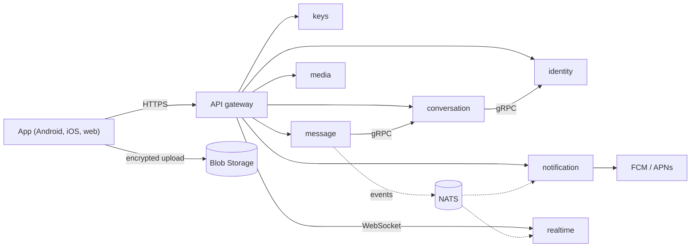

# Pretty Good Pigeon

A messenger where only the people in a conversation can read it.

Messages, photos, group names and even typing indicators are encrypted on your phone before they leave it, using MLS (RFC 9420), the IETF standard for group encryption. Our servers store and forward ciphertext and never hold the keys to read it. The name is a nod to PGP, and to the oldest secure messaging network there is: carrier pigeons.

We are ekipa 13 (Tibor Koderman, Amar Mehić and Eva Vidic), and this is our project for the Cloud Computing course (Računalniške storitve v oblaku) at the Faculty of Computer and Information Science, University of Ljubljana, 2026/27.

## How it works

The app talks to a single API gateway. Behind it, each part of the system is a small service with its own database. Services that need an answer right away call each other over gRPC; everything else is announced as an event on NATS, so a slow or offline service never blocks a message from being delivered. It all runs on Kubernetes in Azure.

## Repositories

| Repository | What it does |
| --- | --- |
| [identity-service](https://github.com/rso-ekipa13/identity-service) | sign-in with passkeys, tokens, organizations and devices |
| [keys-service](https://github.com/rso-ekipa13/keys-service) | public keys and MLS key packages |
| [conversation-service](https://github.com/rso-ekipa13/conversation-service) | chats, groups and members (event sourced) |
| [message-service](https://github.com/rso-ekipa13/message-service) | storing and ordering encrypted messages |
| [realtime-service](https://github.com/rso-ekipa13/realtime-service) | live delivery over WebSocket, presence |
| [media-service](https://github.com/rso-ekipa13/media-service) | encrypted image uploads and downloads |
| [notification-service](https://github.com/rso-ekipa13/notification-service) | content-free push notifications |
| [media-functions](https://github.com/rso-ekipa13/media-functions) | Azure Functions that check and clean up uploads |
| [client-app](https://github.com/rso-ekipa13/client-app) | the Flutter app |
| [platform](https://github.com/rso-ekipa13/platform) | Terraform, cluster setup, local environment |
| [docs](https://github.com/rso-ekipa13/docs) | architecture, decisions and plan |

## Built with

.NET 10 · Flutter · OpenMLS · PostgreSQL · ScyllaDB · NATS JetStream · Envoy Gateway · Kubernetes on Azure (AKS) · Helm · Terraform · GitHub Actions · Prometheus, Grafana and Loki

## Status

We are at the design stage. The first services and the app skeleton are planned for early November 2026, and the finished system is due in January 2027.
